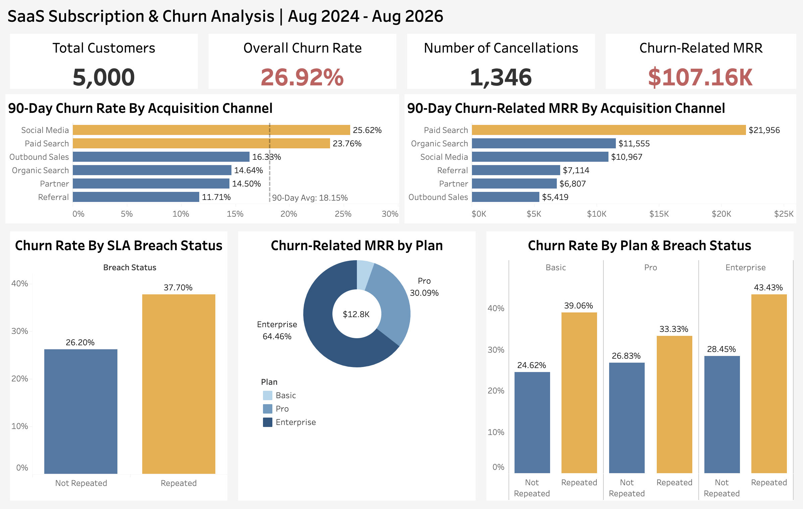
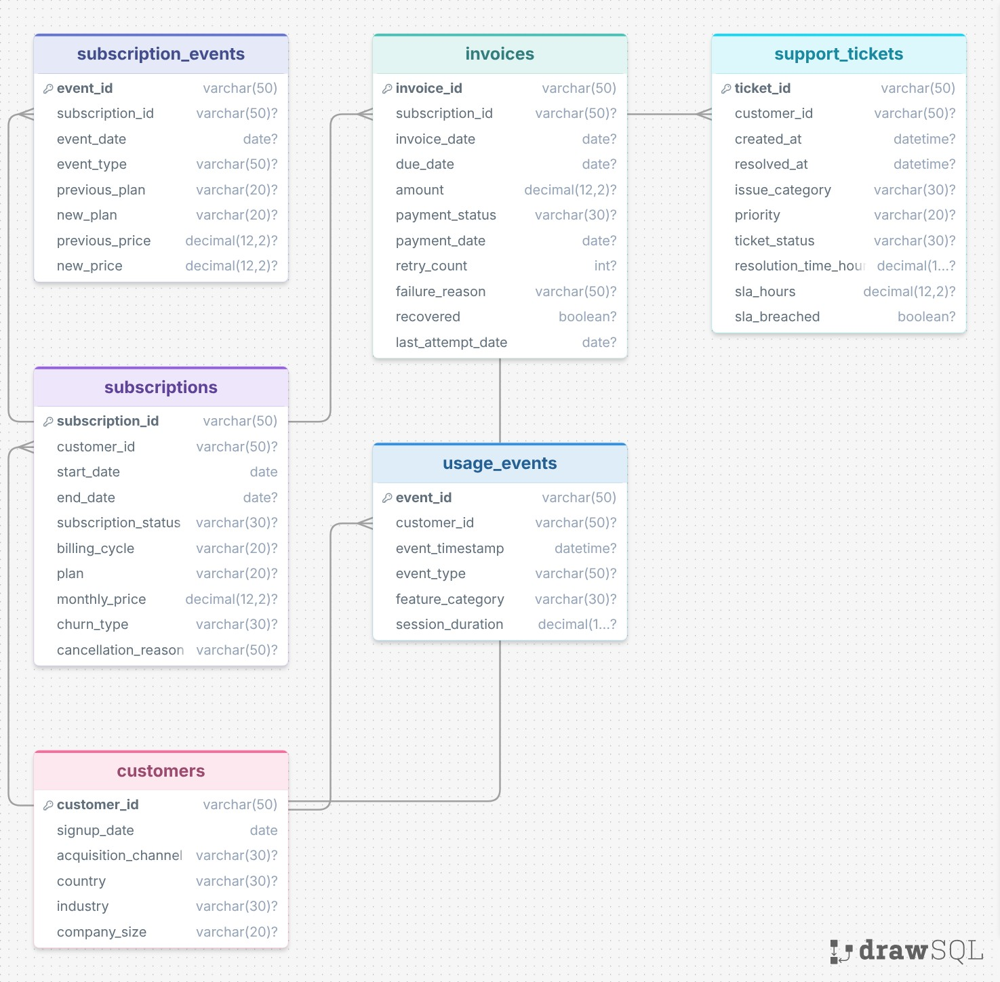

# SaaS Subscription & Churn Analysis

## Executive Summary

Customer retention is critical to the long-term financial performance of subscription-based businesses. High customer acquisition volumes can mask underlying retention problems, while poor support experiences can put valuable recurring revenue at risk.

To investigate these challenges, I generated and cleaned synthetic SaaS subscription data using Python, designed a relational database in MySQL, and built a Tableau dashboard to analyze customer churn, acquisition performance, and support quality.

Across **5,000 customers**, the analysis identified **1,346 cancellations (26.92% churn)**, representing **$107.16K in churn-related Monthly Recurring Revenue (MRR)** over the observation period.

Two areas emerged as retention priorities:

1. **Improve Acquisition Quality:** Social Media (25.62%) and Paid Search (23.76%) have the highest 90-day churn rates among acquisition channels. Together, these channels account for **430 early cancellations and $32.92K in churn-related MRR**. I would recommend that the team investigate acquisition targeting, customer expectations, and early product adoption to identify opportunities to improve retention.
2. **Reduce Repeated SLA Breaches:** Customers experiencing at least two SLA breaches within 90 days have a **37.70% churn rate**, compared with **26.20%** among customers without repeated breaches. The affected group accounts for **$12.81K in churn-related MRR**, suggesting an opportunity to strengthen support escalation and retention processes.
3. **Prioritize High-Value Support Cases:** Enterprise customers account for **$8.26K (64.5%)** of churn-related MRR among customers with repeated SLA breaches. Prioritize escalation of recurring support problems affecting high-value accounts.

## Business Problem

SaaS businesses rely on recurring subscription revenue, making customer retention a fundamental driver of sustainable growth.

However, customer churn can originate from multiple sources. Some customers may be acquired through channels that attract poor-fit users, while others may leave after experiencing unresolved technical problems or repeated service-level failures.

The objective of this project was to investigate customer churn and answer the following questions:

- What is the overall customer churn rate and associated recurring revenue impact?
- Which acquisition channels experience the highest churn within the first 90 days?
- How much churn-related MRR is associated with early cancellations across acquisition channels?
- Do customers experiencing repeated SLA breaches exhibit higher churn rates?
- How does the relationship between SLA breaches and churn differ across subscription plans?
- Which customer segments should be prioritized for retention initiatives?

The analysis focuses on two potential drivers of customer churn: **acquisition quality** and **customer support performance**.

## Methodology

1. **Database Architecture:** Designed a six-table relational database in MySQL (`customers`, `subscriptions`, `subscription_events`, `usage_events`, `invoices`, `support_tickets`) using primary keys, foreign keys, and appropriate data types to represent customer subscriptions and operational activity.
2. **Data Generation & Cleaning:** Used Python, pandas, NumPy, and Faker to generate synthetic customer, subscription, billing, product usage, and support data. Incorporated acquisition and support-related churn patterns, then performed data cleaning and validation.
3. **SQL Analysis:** Developed SQL queries using CTEs, conditional aggregation, date functions, joins, and window functions (`LEAD`) to measure early churn, identify repeated SLA breaches, and compare churn outcomes across customer segments.
4. **90-Day Cohort Analysis:** Calculated early churn using each customer's first 90 days after subscription start. Customers without a complete observation window were excluded unless they had already cancelled within their first 90 days.
5. **Support Performance Analysis:** Identified customers with at least two SLA breaches occurring within a 90-day period. Compared churn rates and associated MRR between customers with and without repeated breaches, including segmentation by subscription plan.
6. **Financial Impact Analysis:** Calculated churn-related MRR by summing the monthly-equivalent subscription prices associated with cancelled subscriptions. Segmented this amount by acquisition channel, SLA breach status, and subscription plan.
7. **Data Visualization:** Built an executive-style Tableau dashboard featuring overall churn KPIs, acquisition-channel comparisons, SLA breach analysis, and churn-related MRR breakdowns.

### Relational Data Model

## Skills

- **Data Architecture:** Relational Database Design (ERD), MySQL DDL (Primary and Foreign Keys), Data Modeling.
- **Programming & Data Analysis:** Python, pandas, NumPy, Faker, Synthetic Data Generation, Data Cleaning and Validation.
- **SQL:** CTEs, Window Functions (`LEAD`), Conditional Aggregation, Joins, Date Calculations, Cohort Analysis, Customer Segmentation.
- **Business Analysis:** Customer Churn Analysis, Revenue Retention, MRR Analysis, Customer Acquisition Performance, Support SLA Analysis.
- **Data Visualization:** Tableau, Calculated Fields, Reference Lines, Executive KPI Design, Dashboard Layout and Visual Storytelling.

## Results and Business Recommendations

### 1. Acquisition Quality: $32.92K in Early Churn-Related MRR

**The Finding:**

Social Media and Paid Search have the highest customer churn rates within the first 90 days of subscription.

| Acquisition Channel | Eligible Customers | Early Cancellations | 90-Day Churn Rate |
|---|---:|---:|---:|
| Social Media | 523 | 134 | 25.62% |
| Paid Search | 1,246 | 296 | 23.76% |
| Outbound Sales | 441 | 72 | 16.33% |
| Organic Search | 977 | 143 | 14.64% |
| Partner | 538 | 78 | 14.50% |
| Referral | 726 | 85 | 11.71% |

The overall 90-day churn rate across eligible customers is approximately **18.15%**.

Social Media exceeds this benchmark by **7.47 percentage points**, while Paid Search exceeds it by **5.61 percentage points**.

Referral has the lowest early churn rate at **11.71%**.

**The Financial Impact:**

| Acquisition Channel | Early Churn-Related MRR |
|---|---:|
| Paid Search | $21,956.15 |
| Organic Search | $11,554.65 |
| Social Media | $10,967.10 |
| Referral | $7,113.80 |
| Partner | $6,806.65 |
| Outbound Sales | $5,418.55 |

Paid Search and Social Media together account for:

- **430 early cancellations**
- **$32,923.25 in churn-related MRR**
- Approximately **44.2% of all early churn-related MRR** across acquisition channels

Paid Search represents the largest financial exposure, combining a high early churn rate with substantial customer volume.

However, high churn alone does not establish that an acquisition channel is unprofitable. Customer acquisition cost, customer lifetime value, and acquisition spending would be needed to assess channel-level profitability.

**Recommendations:**

1. **Audit Paid Acquisition Targeting:** Touch base with marketing to review the audiences, campaign messaging, and targeting criteria used for Paid Search and Social Media. Investigate whether these channels attract customers whose needs are poorly aligned with the product.
2. **Improve Early Customer Onboarding:** Analyze product activation and engagement during the first 30 days. Identify customers who fail to complete important onboarding actions and introduce targeted guidance or customer success outreach.
3. **Evaluate Acquisition Economics:** Connect with marketing to integrate marketing spend and customer acquisition cost (CAC) data to compare channels using retention-adjusted customer lifetime value rather than acquisition volume alone.

### 2. Support Quality: 11.50 Percentage-Point Churn Gap

**The Finding:**

Customers experiencing repeated SLA breaches exhibit substantially higher churn rates than customers without repeated breaches.

A repeated SLA breach is defined as **at least two breached support tickets within a 90-day period**.

| SLA Breach Group | Customers | Cancellations | Churn Rate |
|---|---:|---:|---:|
| Repeated SLA Breaches | 313 | 118 | 37.70% |
| No Repeated SLA Breaches | 4,687 | 1,228 | 26.20% |

Customers with repeated SLA breaches have:

- An **11.50 percentage-point higher churn rate**
- Approximately **43.9% higher relative churn**
- **118 cancellations**, all occurring after the second qualifying SLA breach in the observed data

The timing supports further investigation into support quality as a potential retention factor, but it does not establish that the breaches caused the cancellations.

**The Financial Impact:**

Customers experiencing repeated SLA breaches account for:

- **$12,812.60 in churn-related MRR**
- **$108.58 average MRR per cancelled customer**

By comparison, customers without repeated breaches have an average of **$76.83 in churn-related MRR per cancelled customer**.

This indicates that cancellations among customers with repeated SLA breaches are associated with higher-value subscriptions on average.

Note that the $12.81K figure represents historical MRR associated with cancellations in the affected group, not a guaranteed revenue recovery opportunity.

**Recommendations:**

1. **Implement Proactive Escalation Rules:** Automatically flag customers after their second SLA breach within 90 days and prioritize follow-up before additional support failures occur.
2. **Monitor Recurring Support Problems:** Track repeated technical issues, unresolved tickets, and SLA breach frequency at the customer level rather than evaluating each support ticket independently.
3. **Introduce Risk-Based Customer Outreach:** Coordinate between support and customer success teams to proactively contact customers experiencing repeated service failures.
4. **Measure Retention Outcomes:** Monitor churn rates among customers receiving proactive support intervention and compare them with an appropriate control group.

### 3. Enterprise Support Risk: $8.26K in Churn-Related MRR

**The Finding:**

The relationship between repeated SLA breaches and customer churn varies across subscription plans.

| Subscription Plan | No Repeated Breaches | Repeated Breaches |
|---|---:|---:|
| Basic | 24.62% | 39.06% |
| Pro | 26.83% | 33.33% |
| Enterprise | 28.45% | 43.43% |

Enterprise customers experiencing repeated SLA breaches have the highest observed churn rate at **43.43%**, compared with **28.45%** among Enterprise customers without repeated breaches.

This represents a **14.98 percentage-point difference**.

**The Financial Impact:**

Among cancelled customers experiencing repeated SLA breaches:

| Subscription Plan | Cancellations | Churn-Related MRR | Share |
|---|---:|---:|---:|
| Enterprise | 43 | $8,258.50 | 64.5% |
| Pro | 50 | $3,855.20 | 30.1% |
| Basic | 25 | $698.90 | 5.5% |
| **Total** | **118** | **$12,812.60** | **100%** |

Enterprise customers account for nearly two-thirds of churn-related MRR in the repeated-breach group despite representing fewer cancellations than Pro customers.

This suggests that support failures affecting Enterprise accounts warrant particular attention because of their greater recurring revenue exposure.

**Recommendations:**

1. **Prioritize High-Value Accounts:** Introduce escalation procedures that consider subscription value, ticket severity, and repeated SLA breaches when allocating support resources.
2. **Strengthen Enterprise Support Monitoring:** Create account-level alerts for recurring SLA violations and involve customer success managers when high-value customers experience repeated issues.
3. **Evaluate Intervention Effectiveness:** Track retention outcomes and support costs for escalated Enterprise accounts to determine whether proactive intervention produces a positive financial return.

*(View the full interactive Tableau Dashboard [here](https://public.tableau.com/app/profile/bryant.cortez/viz/FunnelAnalysis_17933177896900/FunnelAnalysisDashboard?publish=yes) or download the `.twbx` file in this repo).*

## Next Steps

1. **Investigate Early Product Adoption:** Use product usage events to compare activation rates, feature engagement, and early usage patterns between retained customers and customers who churn within 90 days. Determine whether poor initial engagement helps explain acquisition-channel differences.
2. **Integrate Customer Acquisition Costs:** Incorporate marketing spend and CAC data to evaluate acquisition channels using retention-adjusted customer lifetime value and payback periods.
3. **Pilot Support Escalation Interventions:** Introduce proactive escalation after a second SLA breach within 90 days. Test whether the intervention improves retention compared with a suitable control group, beginning with high-value Enterprise accounts.
4. **Develop an Early-Warning Retention Model:** Combine acquisition channel, subscription plan, product usage, billing history, and support activity to identify customers at elevated churn risk. Use only information available before the prediction date to prevent data leakage.
5. **Track Retention Over Time:** Expand the analysis to include monthly signup cohorts, churn trends, and recurring revenue retention metrics to evaluate whether customer retention improves following operational changes.

## Limitations and Assumptions

- **Synthetic Data:** The dataset was generated using Python to simulate SaaS subscription activity.  The findings demonstrate analytical methods and business reasoning but do not represent relationships discovered in real customer data.
- **No Causal Inference:** Higher churn among customers with repeated SLA breaches does not prove that the breaches caused cancellations. Controlled experiments or stronger observational methods would be needed to estimate causal effects.
- **Observation Period:** The synthetic dataset covers customer activity from August 2024 through August 1, 2026. The 90-day churn calculations account for the observation cutoff to reduce incomplete-follow-up bias.
- **Missing Acquisition Economics:** Marketing spend, CAC, and customer lifetime value were not included in the acquisition analysis. Therefore, higher early churn cannot independently establish that a channel is unprofitable.
- **Financial Recovery Is Uncertain:** The analysis identifies historical churn-related revenue exposure rather than directly estimating recoverable revenue. Realized financial benefits would depend on intervention effectiveness, implementation costs, and customer behavior.
